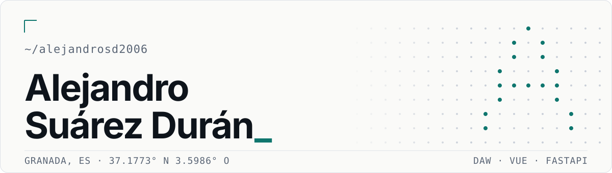
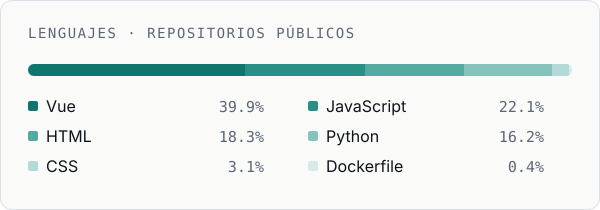

<picture>
  <source media="(prefers-color-scheme: dark)" srcset="assets/banner-dark.svg">
  
</picture>

  <a href="#proyectos">Proyectos</a> &nbsp;/&nbsp;
  <a href="#stack">Stack</a> &nbsp;/&nbsp;
  <a href="#actividad">Actividad</a> &nbsp;/&nbsp;
  <a href="#contacto">Contacto</a>

Estudiante de Desarrollo de Aplicaciones Web en Granada. Construyo aplicaciones web de principio a fin: interfaz en **Vue 3**, API en **Python con FastAPI**, pruebas automatizadas y documentación que explica las decisiones.

|   |   |
|---|---|
| **Formación** | Desarrollo de Aplicaciones Web (DAW) |
| **Ubicación** | Granada, España |
| **Trabajo actual** | Interfaces con Vue 3, APIs REST con autenticación, despliegue con Docker |
| **En formación** | Python para análisis de datos |

 

## Proyectos

### [Flashcard](https://github.com/AlejandroSD2006/Flashcard)

Juego de memoria con fotografías propias y una capa de gamificación: puntuación con rachas, XP y niveles, insignias, ranking local y un modo duelo 1 contra 1 en el mismo dispositivo. Funciona entero en el navegador, con las imágenes en IndexedDB.
La validación de respuestas normaliza tildes y mayúsculas y tolera una errata. Incluye 48 pruebas unitarias.

`Vue 3` `Vite` `IndexedDB` `Vitest`

### [App2 WhatIf](https://github.com/AlejandroSD2006/app2-whatif)

Aplicación de una sola pantalla que genera historias alternativas con IA a partir de una hipótesis histórica. El acceso está protegido: el backend verifica la sesión antes de llamar al modelo y rechaza con 401 cualquier petición sin token válido. Proyecto en pareja, especificado antes de programar con Spec Kit y documentado como ERS.

`Vue 3` `Tailwind CSS 4` `Clerk` `FastAPI` `OpenRouter` `Docker Compose` `pytest`

### [GymLog](https://github.com/AlejandroSD2006/gymlog)

Registro de entrenamientos: rutinas, ejercicios y evolución de peso, series y repeticiones. Sin dependencias ni backend; los datos viven en el navegador.

`HTML` `CSS` `JavaScript`

 

## Stack

Lo que he usado en los proyectos de arriba.

  
  
  
  
  
  

  
  
  
  

  
  
  
  
  

**En formación** · datos con Python

  
  
  
  

 

## Actividad

<picture>
  <source media="(prefers-color-scheme: dark)" srcset="assets/languages-dark.svg">
  
</picture>

Gráfico generado con la API de GitHub a partir de mis repositorios públicos y actualizado cada semana ([script](scripts/make_languages.py)).

 

## Contacto

Por ahora, a través de GitHub: abre un issue en cualquiera de mis repositorios o sígueme para ver novedades.

<!-- Cuando haya canal publico (correo, LinkedIn), anadirlo aqui. -->
